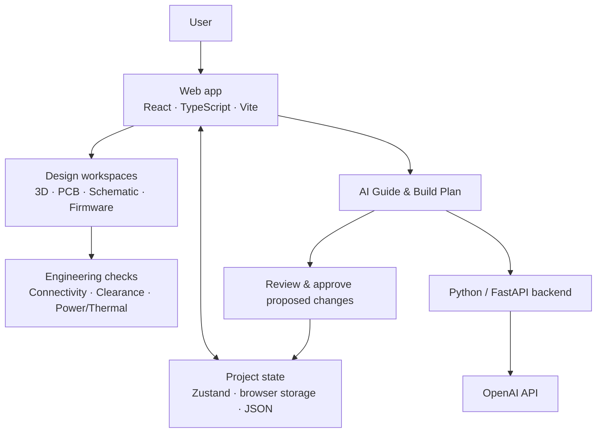

# Nexora — Architecture & Features

**Nexora** is an AI-assisted hardware design workspace that brings 3D modeling, PCB layout, schematic editing, firmware, and engineering guidance into one browser application.

## Architecture

## Main Tech Stack

| Layer | Technologies |
| --- | --- |
| Frontend | React, TypeScript, Vite, HTML/CSS |
| 3D visualization | Three.js, React Three Fiber, Drei |
| State & persistence | Zustand, browser storage, JSON import/export |
| AI & backend | Python, FastAPI, OpenAI API |
| Firmware editor | Monaco Editor |
| Testing & tooling | Vitest, Playwright, Python unittest, Git/GitHub |

## Core Features

- **3D Design Studio:** Place and inspect components, adjust transforms, and navigate the PCB visually.
- **PCB & Schematics:** Edit board layouts, footprints, pads, layers, nets, and conceptual connections; inspect airwires and basic design-rule findings.
- **AI Hardware Mentor:** Retain project goals and conversations, offer Beginner/Engineer explanations, create build plans, and propose changes for user approval.
- **Firmware & Design Review:** Manage firmware drafts and examine connectivity, power, and thermal estimates with clearly stated assumptions.
- **Project Management:** Save, duplicate, import/export, and undo/redo changes across independent projects.

## How It Fits Together

The React application owns the design workspace and local project state. The optional FastAPI service supplies context-aware AI assistance through OpenAI. Proposed project changes must pass validation and explicit user approval before application.

> **Current scope:** Nexora supports visual hardware design and preliminary engineering review. It does **not** yet provide full circuit simulation, automatic copper routing, manufacturing-ready verification, or live firmware compilation. Some models and terminals are conceptual.

**Run locally:** `npm ci` followed by `npm run dev`. Online AI requires separate backend setup; see the [AI integration guide](ai-integration.md).
